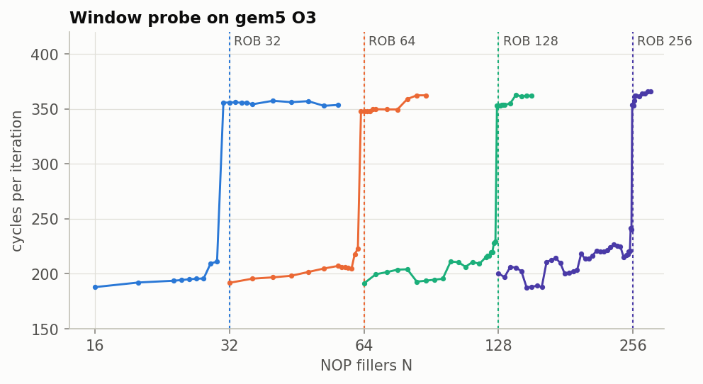
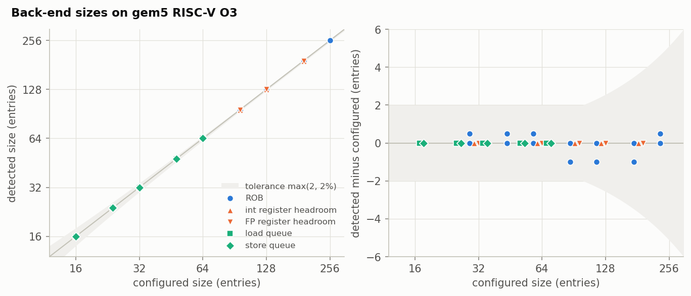
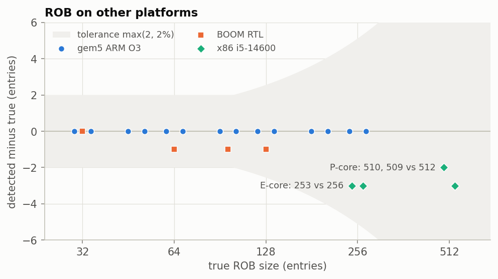
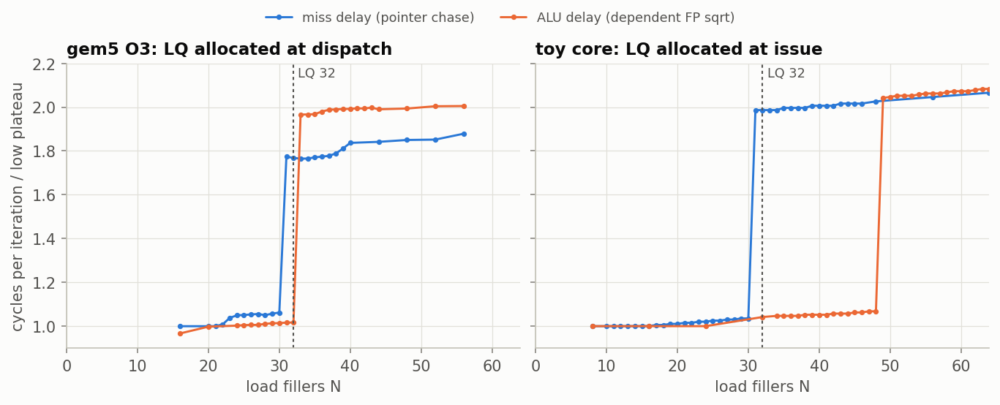

# uarch-re

Microbenchmarks that recover the hidden structure sizes of an out-of-order
core (ROB, register files, load/store queues, schedulers, caches, branch
predictors) from timing alone. Every method is checked on cores where the
answer is known (a toy model, gem5, BOOM RTL, x86 with published sizes)
before it is used on the Apple M1 Firestorm.

## The window probe

```
loop:
  A = *A            # cache miss on chain A
  N x filler
  B = *B            # cache miss on chain B, independent of A
  N x filler
```

While both misses and the fillers fit in the window, the misses overlap and
an iteration costs about one miss latency. Once they don't, the misses
serialize and the cost doubles. It works like a waiting room: two slow
visitors are served together only while both fit inside.

The filler picks the structure:

| filler | fills |
| --- | --- |
| nop | ROB |
| int, fp | ROB and the int or FP register headroom (physical minus architectural registers) |
| load | ROB and the load queue |
| store | ROB and the store queue |

The size is the knee plus a small offset for the entries the loop itself
holds. Offsets are calibrated on gem5 and the toy model
(`uarchre/analysis/offsets.yaml`). Anomaly rules A1-A12
(`uarchre/analysis/anomaly.py`) flag curves this simple model can't explain,
and a flagged structure is reported as a bound instead of a value.

## Results



Four gem5 ROB sizes. Each curve steps two fillers early because the two miss
loads hold ROB entries too.



51 gem5 configurations, all within max(2, 2%). Points on the right are
nudged apart in x.



ROB error on other platforms. The shaded band is the tolerance.



Rule A5. With the LQ allocated at dispatch (gem5), a miss delay and an ALU
delay give the same LQ size once offsets are added. With the LQ allocated at
issue (toy core), loads behind an ALU delay wait in the scheduler without an
LQ entry, so the knees split and the LQ is reported as a bound.

- gem5: ROB 21/21 configurations, register headroom 10/10, LQ/SQ 20/20.
  Caches, TLBs, MSHRs, store sets, fetch width, BTB, branch history, RAS and
  fetch queue all track their configured values.
- BOOM RTL: ROB 4/4 (32-128).
- gem5 ARM: ROB 14/14 with the AArch64 emitter.
- x86 (i5-14600): ROB 510 on the P-core and 253 on the E-core, against
  Intel's 512 and 256. x86 offsets aren't calibrated yet; most x86 sizes
  read 0-5 entries low.
- M1: waiting on hardware. The macOS driver (`targets/m1/`) hasn't run on a
  Mac yet.

Per-experiment status: [`docs/pocs.md`](docs/pocs.md).

## Layout

```
uarchre/kernels/    experiments, ISA-independent
uarchre/backends/   ISA emitters (x86-64, RV64, AArch64) and platforms (native, gem5, BOOM, toy model)
uarchre/analysis/   knee detection, bootstrap intervals, offsets, anomaly rules
sweep.py            command-line sweep driver
spec/               core spec schema and specs (Firestorm, R10000)
validation/         gem5, BOOM and toy-model campaigns
targets/            x86 and M1 drivers
explainer/          JS factory model of the core and a register-renaming lab
exporters/          spec -> gem5 config
tests/
```

`build/`, `results/` and `refs/` are symlinks to local scratch
(`/var/tmp/$USER/uarch-re`).

## Quick start

```
. tools/env.sh                     # cross compilers, gem5 path, scratch checks
python3 -m unittest                # ~150 tests, ~45 s
./sweep.py toy --tag t --toy rob=64,int_prf=72,lq=24,sq=16 --n 2:90:2
./sweep.py native --tag host --fillers nop,int,fp,load,store --n 16:560:16 --pin-cpu 2
./sweep.py gem5 --tag rob128 --gem5 numROBEntries=128 --fillers nop --n 32:200:8 --jobs 12
validation/gem5/arm_sweep.py --tag arm-rob64 --gem5 numROBEntries=64 --fillers nop --n 40:80:8
python3 tools/figures.py           # docs/figures/
```

gem5 needs `validation/gem5/build.sh` (`ISA=RISCV` or `ISA=ARM`). `--set`
overrides any gem5 parameter by dotted path. BOOM: `validation/boom/`.
